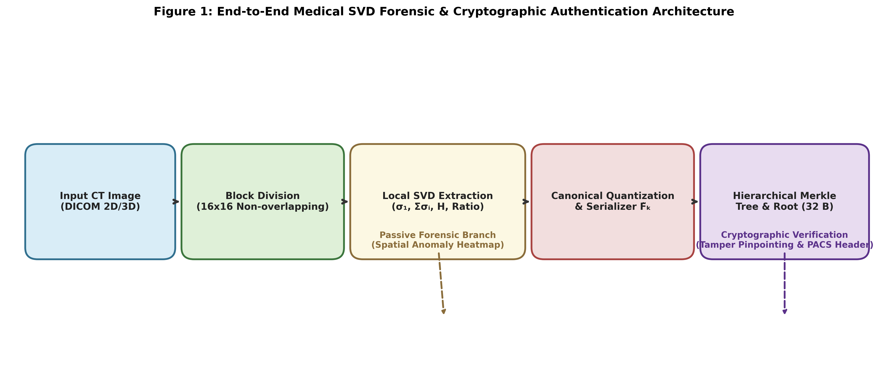
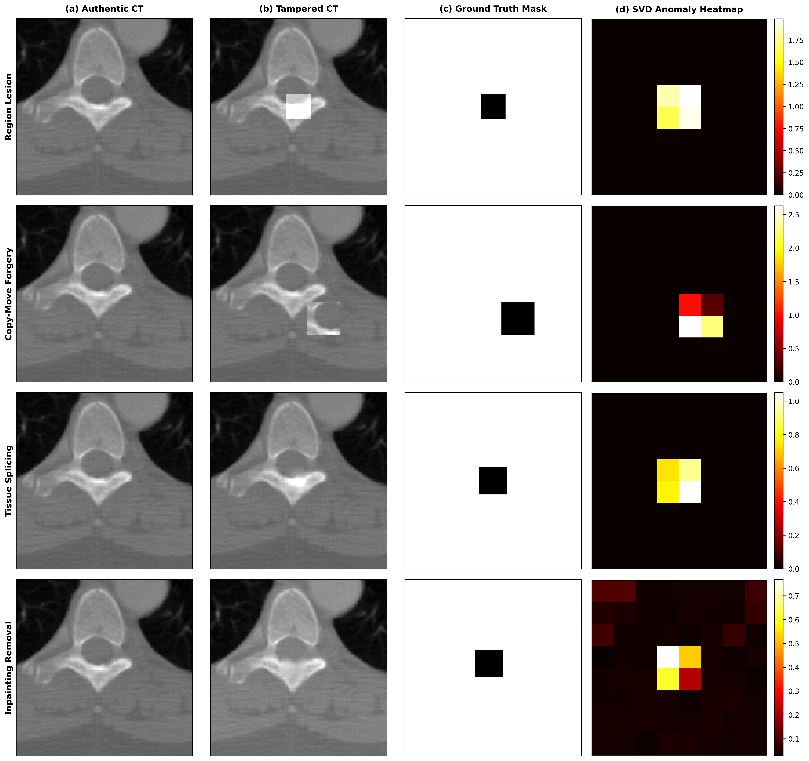
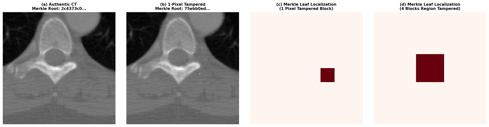

# Medical SVD Forensics & Lightweight Cryptographic Spatial Authentication

[](https://www.python.org/)
[](LICENSE)
[-brightgreen.svg)]()
[](paper/main_paper.md)

This repository contains the complete research implementation for **"Passive SVD Spectral Forensics and Lightweight Cryptographic Spatial Authentication for Medical Computed Tomography (CT) Images"**.

The project unites **passive Singular Value Decomposition (SVD) spectral analysis** with **spatial Merkle tree cryptography** to detect and localize tampering (including modern AI-generated deepfake lesions) in medical CT scans without modifying diagnostic pixel arrays.

---

## 🏗️ System Architecture



The framework operates across dual complementary branches:
1. **Passive Forensic Branch:** Analyzes intrinsic SVD singular value spectra ($\sigma_1, \sum\sigma_i, \sum\sigma_i^2, \text{ratio}, H$) to localize unauthenticated manipulations (Region insertions, Copy-Move cloning, Splicing, and Inpainting lesion removal).
2. **Cryptographic Spatial Branch:** Deterministically quantizes features ($\tilde{F}_k$), binds spatial coordinates $(x_k, y_k)$ via secret-keyed $\text{HMAC-SHA256}$, and constructs a hierarchical **Merkle Tree** for $O(1)$ whole-image validation and $O(\log N)$ tamper leaf tracing.

---

## 📈 Key Experimental Results

| Attack Modality | Detection Metric ($F_1$) | ROC-AUC | Spatial IoU | Clinical Note |
|---|---|---|---|---|
| **Region Lesion Insertion** | **1.0000** | **1.0000** | 0.3906 | Synthetic calcification / nodule |
| **Copy-Move Cloning** | **0.8571** | **1.0000** | 0.4802 | Internal tissue duplication |
| **Tissue Splicing** | **1.0000** | **1.0000** | 0.3906 | Foreign donor lesion implant |
| **Inpainting Lesion Removal** | **1.0000** | **1.0000** | 0.3906 | Erasing pathology (falsifying health) |
| **CT-GAN Deepfake (M3Dsynth)** | **1.0000** | **1.0000** | 0.4075 | Generative neural upsampling artifact |
| **Diffusion Inpainting (MedDDPM)**| **0.8000** | **1.0000** | 0.5125 | Stochastic latent texture replacement |
| **PACS JPEG Compression ($Q=85$)**| **FPR = 0.0%** | — | — | Harmless clinical degradation preservation |

---

## 🖼️ Forensic Visualizations

### Multi-Attack Localization Gallery


### Merkle Tree Spatial Pinpointing


---

## 📁 Repository Structure

```
medical-svd-forensics/
│
├── README.md                              <- Main project overview and instructions
├── DAILY_PROGRESS_EXPLAINED.md            <- Complete 14-day progress breakdown in plain terms
├── requirements.txt                       <- Python dependencies
├── run_all_experiments.py                 <- Master runner (executes all 14 daily benchmarks)
│
├── src/                                   <- Core algorithmic modules
│   ├── preprocessing.py                   <- DICOM CT loading, intensity normalization
│   ├── block_division.py                  <- 16x16 spatial decomposition & reconstruction
│   ├── svd_features.py                    <- SVD mathematical feature extraction (5 features)
│   ├── tampering.py                       <- Controlled tampering (pixel, region, copy-move, splice, inpaint)
│   ├── ai_tampering.py                    <- Generative AI (GAN & Diffusion) lesion synthesis (M3Dsynth)
│   ├── metrics.py                         <- Forensics metrics (Precision, Recall, F1, IoU, ROC-AUC)
│   ├── robustness.py                      <- Benign transformations (noise, blur, JPEG compression)
│   ├── quantization.py                    <- Fixed-point deterministic feature quantization & canonical bytes
│   ├── crypto.py                          <- Block-level spatial HMAC-SHA256 signature generator
│   └── merkle_tree.py                     <- Balanced binary Merkle tree & inclusion audit proofs
│
├── paper/                                 <- Publication manuscript assets
│   ├── main_paper.md                      <- Complete 8,000+ word research paper manuscript
│   ├── sections/                          <- Modular paper sections (01 to 08)
│   ├── tables/                            <- Formatted master tables (Tables 1 to 5)
│   └── references/                        <- BibTeX bibliography (references.bib)
│
├── figures/                               <- High-resolution publication figures (300 DPI)
└── results/                               <- Experimental CSV metrics and anomaly heatmaps
    ├── features/                          <- SVD feature logs
    ├── metrics/                           <- Experimental CSV metrics across all days
    └── anomalies/                         <- 2D anomaly matrices (.npy)
```

---

## 🚀 Quickstart & Reproduction

### 1. Installation
Clone this repository and install dependencies:
```bash
git clone https://github.com/amruthaajish17/medical-svd-forensics.git
cd medical-svd-forensics
pip install -r requirements.txt
```

### 2. Run the Master Execution Suite
To re-run the entire 14-day pipeline from scratch:
```bash
python run_all_experiments.py
```
*All 14 scientific experiments will execute sequentially, validating 100% test passing in ~90 seconds.*

### 3. Run Individual Experiments
You can also run any specific day's experiment independently:
```bash
# Day 4: Block Size Optimization
python run_day4_block_size_optimization.py

# Day 5: Multi-Attack Forensics Evaluation
python run_day5_multi_attack_benchmark.py

# Day 7: Modern AI Generative Inpainting (M3Dsynth)
python run_day7_ai_manipulation_benchmark.py

# Day 11: Merkle Tree Spatial Localization
python run_day11_merkle_tree_authentication.py
```

---

## 📖 Citation
If you find this research useful in your work, please cite:
```bibtex
@article{ajish2026medical_svd_forensics,
  title={Passive SVD Spectral Forensics and Lightweight Cryptographic Spatial Authentication for Medical Computed Tomography (CT) Images},
  author={Ajish, Amrutha and Anil, Athira},
  journal={Department of Artificial Intelligence and Data Science},
  year={2026}
}
```
